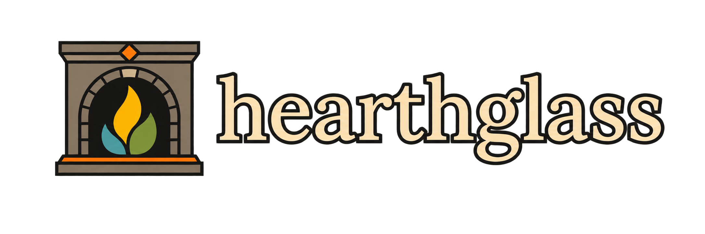

# Hearthglass themes

<p align="center">
  
</p>

<p align="center">
  Nine Neovim colorschemes for the glow between dark and light.
</p>

The `hearthglass.nvim` plugin ships the Hearthglass family. Its original dark
variant (`hearthglass`) leans into gruvboxy warmth: warm ivory foregrounds over
earthy brown backgrounds, with orange as the UI hero, rose for keyword syntax
and gold for types. Green and red are reserved as context signals — git diffs,
diagnostics, success and error states. The light variant is orange-forward: a
burnt orange hero that clears the parchment, so the gold family never washes
out against the light background. Functions run steel blue and the
preprocessor terracotta in both variants, so the accent family stays in play
instead of collapsing into one warm monochrome.

The same family is also shipped for other tools: kitty terminal themes and
Zed Editor themes, both generated from the compact palettes in
`lua/hearthglass/themes.lua` so they move together. Every palette — all nine
families — also ships as a full KDE Plasma 6 global theme (light and dark)
under `kde/`, shaped after Clay. See [`kde/README.md`](kde/README.md) for the
build, install and apply commands.

## Variants

Nine families. Every theme has a dark and a light face:

| Theme | Key | Hero | Feel |
| --- | --- | --- | --- |
| Hearthglass | `hearthglass` | amber | the original: amber hero, ivory ink, hearth ash |
| Stained Glass | `stainedglass` | hot orange | Gruvbox bones, stained-glass retro warmth, brighter red |
| Flame Glass | `flameglass` | vermilion | ruby glass, hot open red, warmer than wine |
| Cranberry Glass | `cranberryglass` | rose red | cranberry glass, wine-dark plum |
| Sea Glass | `seaglass` | coral | sea glass over a deep teal shadow, coral hero, cyan rim |
| Smoked Glass | `smokedglass` | warm orange | smoked gray surfaces, one accent, gray syntax support |
| Frosted Glass | `frostedglass` | frost cyan | polar blue-gray glass, aurora accents, cold and soft |
| Cathedral Glass | `cathedralglass` | glass lilac | ink black, peony, carp yellow, spring green |
| Leaded Glass | `leadedglass` | forest green | leaded glass, cream light, autumn orange, river aqua |

The family spans amber, hot orange, vermilion, wine, coral, smoked gray, polar
blue, ink lilac and forest green. Stained Glass is the Gruvbox-inspired
variation. Smoked Glass is deliberately minimal, with one warm accent and gray
syntax support. Frosted Glass, Cathedral Glass and Leaded Glass keep several
unrelated accents in play, so their highlight patterns stay colorful.

Only Seaglass is anchored to the photographed petal reference: deep teal
shadow `#0e2426`, coral petal `#e08a6d`, cyan rim `#5fd6d2`, amber pollen
`#d98f3a` and bone highlight `#f3ded0`. Its dark face uses those values
directly; the light face keeps the same hue angles and moves lightness only as
far as WCAG contrast needs.

## Naming

The plugin is `hearthglass.nvim`; the collection is the Hearthglass family.
Every display name ends in Glass, and every key ends in `glass`. The names are
Hearthglass, Stained Glass, Flame Glass, Cranberry Glass, Sea Glass, Smoked
Glass, Frosted Glass, Cathedral Glass and Leaded Glass. Keys use no spaces,
`-light` selects the light face, and file stems and KDE package IDs use the
key. For example `colors/frostedglass.lua`, `kitty/frostedglass.conf`,
`zed/frostedglass.json` and `org.hearthglass.frostedglass.desktop`.

```vim
:colorscheme hearthglass
:colorscheme hearthglass-light
:colorscheme hearthglass-auto

:colorscheme stainedglass
:colorscheme flameglass
:colorscheme seaglass
:colorscheme smokedglass
```

`hearthglass-auto` follows the desktop theme when KDE or GNOME settings are
available, then falls back to `background`.

Switch theme without changing the current face:

```vim
:HearthglassTheme leadedglass        " dark stays dark, light stays light
:HearthglassTheme               " list the family, with * on the active theme
```

Toggle the active variant with:

```vim
:HearthglassToggle
```

Refresh from the current system preference after changing the desktop theme:

```vim
:HearthglassSync
```

On KDE, Hearthglass reads the `ColorScheme` value from `kdeglobals`. On
GNOME-compatible desktops, it reads `org.gnome.desktop.interface color-scheme`
through `gsettings`.

The same API is available from Lua:

```lua
local hearthglass = require('hearthglass')
hearthglass.toggle()
hearthglass.set_theme('cranberryglass')
hearthglass.list()
```

## Installation

### vim.pack

```lua
vim.pack.add {
  'https://github.com/McCune1224/hearthglass.nvim',
}

vim.cmd.colorscheme 'hearthglass'
```

### lazy.nvim

```lua
{
  'McCune1224/hearthglass.nvim',
  lazy = false,
  priority = 1000,
  config = function()
    vim.cmd.colorscheme 'hearthglass'
  end,
}
```

## Configuration

```lua
require('hearthglass').setup {
  low_blue_light = true,
}
```

`low_blue_light` only affects the light variant: it lifts the parchment
background toward white for a brighter "paper" feel.

### Colorblind-friendly modes

hearthglass uses exactly one accent pair for meaning — green for success
(diffs, `DiagnosticOk`, `Todo`) and red for error (`DiagnosticError`,
`DiffDelete`) — and that pair is the one most commonly confused. A
colorblind-safe remap replaces it:

```lua
require('hearthglass').setup {
  colorblind = 'deutan', -- or true, 'protan', 'tritan'
}
```

- `deutan` / `protan` (red-green deficiency, the common case): red shifts
  toward rose and green toward teal. Both keep enough blue component to stay
  apart for deuteranopia and protanopia, and cyan moves to a darker steel so
  it does not collide with the new teal. The olive and brick syntax slabs are
  re-tinted to match.
- `tritan` (blue-yellow deficiency): blue shifts toward purple and cyan
  toward steel so they stop colliding with the gold/yellow family.
- `true` is an alias for `'deutan'`.

The remap applies to both the dark and light variants, survives
`:HearthglassToggle` / `:HearthglassSync`, and the lualine themes follow it.
Cursor and search keep the theme's single hero accent in every mode.

For lualine, use the matching theme explicitly:

```lua
require('lualine').setup {
  options = {
    theme = 'hearthglass',
  },
}
```

The repository also includes `hearthglass-light` under `lua/lualine/themes/`.
Every theme in the family ships a lualine theme under its own key
(`stainedglass`, `flameglass`, `seaglass`, ...), so `theme = vim.g.colors_name`
follows whichever colorscheme is active.

## Terminal (kitty)

Every theme in the family is available as a kitty terminal theme, with
matching day and night confs. The shipped files are `kitty/<key>.conf` (dark)
and `kitty/<key>-light.conf` (light). The Python CLI reads
`kitty/palettes.json`, a snapshot exported from `lua/hearthglass/themes.lua`
and derived by `lua/hearthglass/colors.lua`; it carries no palette of its own
and honors the same `low_blue_light` and `colorblind` options as the
colorscheme.

```sh
python3 kitty/hearthglass.py list
```

Note: `kitty/hearthglass.py` is a plain script — run it with `python3`, not as a
`kitten` subcommand. This kitty only ships its builtin kittens. The script
delegates all theme changes to the `kitten` CLI tool.

### Switch with `kitten themes` (recommended)

Install the confs so the `kitten themes` CLI can find them:

```sh
python3 kitty/hearthglass.py install          # every theme
python3 kitty/hearthglass.py install --theme flameglass
```

The generated confs carry kitten metadata, so the picker shows readable names
(`Hearthglass`, `Stained Glass`, `Flame Glass`, `Sea Glass`, and so on). Switch
through the kitten CLI:

```sh
kitten themes                    # interactive picker
kitten themes "Cranberry Glass"        # dark
kitten themes "Cranberry Glass Light"  # light
```

### Apply live (day / night / toggle)

For a non-persistent switch on the running kitty, use `kitten @ set-colors`.
The script wraps it (it needs kitty remote control enabled in `kitty.conf`):

```sh
allow_remote_control yes
listen_on unix:/tmp/kitty
```

```sh
python3 kitty/hearthglass.py night                  # original dark
python3 kitty/hearthglass.py day                    # original light
python3 kitty/hearthglass.py toggle                 # flip the theme's faces
python3 kitty/hearthglass.py night --theme seaglass      # Sea Glass, dark
python3 kitty/hearthglass.py day --theme leadedglass     # Leaded Glass, light
```

Or call the kitten CLI directly:

```sh
kitten @ set-colors kitty/seaglass.conf
```

Each script command honors the same options as the colorscheme:

```sh
python3 kitty/hearthglass.py day --theme cranberryglass --low-blue-light
python3 kitty/hearthglass.py night --theme cathedralglass --colorblind deutan
```

Regenerate every conf from the palette (after changing a theme or options)
with:

```sh
nvim --headless -l kitty/export.lua
python3 kitty/hearthglass.py build kitty
```

`build` refreshes `kitty/palettes.json` from `themes.lua` automatically when
Neovim is available.

## Zed Editor

Every theme in the family is available as a Zed Editor theme family, with
matching day and night faces, for example `Hearthglass Cranberry Glass Dark` and
`Hearthglass Cranberry Glass Light`. The theme files live at `zed/<key>.json`
(`zed/hearthglass.json` for the original) and are generated from
`lua/hearthglass/themes.lua`, so Zed and Neovim always share one palette.

Zed reads themes from `~/.config/zed/themes/`, so install the whole family:

```sh
nvim --headless -l zed/build.lua --install
```

Or copy a single family by hand:

```sh
cp zed/cranberryglass.json ~/.config/zed/themes/cranberryglass.json
```

Then pick a family from Zed's theme picker (`zed: open theme picker`), or set
one in `settings.json`:

```json
{
  "theme": {
    "mode": "system",
    "light": "Hearthglass Cranberry Glass Light",
    "dark": "Hearthglass Cranberry Glass Dark"
  }
}
```

Regenerate the files after changing a palette or the options:

```sh
nvim --headless -l zed/build.lua                        # every family
nvim --headless -l zed/build.lua --theme seaglass        # one family
nvim --headless -l zed/build.lua --install              # every family, into Zed
nvim --headless -l zed/build.lua --colorblind deutan
```

The options are the same ones the colorscheme and the kitty theme honor, so
all three stay in step.

A couple of notes on how the theme maps onto Zed:

- Zed highlights code with tree-sitter captures instead of Vim highlight
  groups, so the deepwhite pastel slabs behind strings, constants and keywords
  carry over as `background_color` on the matching captures. The result keeps
  the warm-block look of the Neovim theme.
- Zed has no cursor or search highlight groups, so the theme's hero accent
  moves up into the UI layer: focused borders, the accent text color and the
  active search match all use it.
- Zed's `vim.*` colors paint the Vim mode indicator; they reuse the
  mini.statusline slabs from the Neovim theme.

## KDE Plasma

All nine palettes are shipped as full Plasma 6 global themes, each with a
light and dark face, under `kde/`. They follow Clay's component set: colour
scheme, Plasma style, Aurorae window decoration, wallpaper, splash/lock/logout,
icons, cursors, Kate theme and Alt+Tab switcher.

```sh
./kde/install.sh
./kde/apply.sh cranberryglass dark
./kde/apply.sh seaglass dark
./kde/apply.sh flameglass dark
./kde/verify.sh
```

`apply.sh` also installs the family's confs into `~/.config/kitty/themes`
(so they appear in `kitten themes`) and writes the matching
`dark-theme.auto.conf` / `light-theme.auto.conf`, so the terminal follows the
same family automatically. See
[`kde/README.md`](kde/README.md) for the full component list, the colour
mapping, manual installation, and how to add another palette.

## Quality checks

The repository ships three headless checks:

```sh
# WCAG contrast: base0 >= 7:1, comments/hero/accents >= 4.5:1,
# syntax text >= 4.5:1 on its tinted slab, every dark and light face.
nvim --headless -l scripts/audit-contrast.lua

# Palettes in kitty/palettes.json, zed/*.json and kde/palettes.json
# match themes.lua / colors.lua exactly.
nvim --headless -l scripts/check-drift.lua

# Every colorscheme loads and its highlight groups resolve to real colors.
nvim --headless -l scripts/check-colorschemes.lua
```

## Regenerating every integration

The palettes live in `lua/hearthglass/themes.lua`; each integration has its own
generator. After editing a theme, regenerate the shipped artifacts:

```sh
nvim --headless -l kitty/export.lua
python3 kitty/hearthglass.py build kitty
nvim --headless -l zed/build.lua
nvim --headless -l kde/export.lua && python3 kde/build.py
```

## Inspirations

hearthglass draws on two existing projects:

- [deepwhite.nvim](https://github.com/Verf/deepwhite.nvim) — the
  highlight-group organization and visual structure (MIT License)
- [Ember](https://embertheme.com/) and its Neovim port at
  [ember-theme/nvim](https://github.com/ember-theme/nvim) — the palette
  direction
