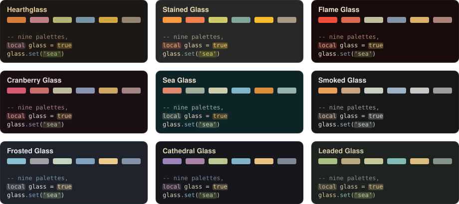
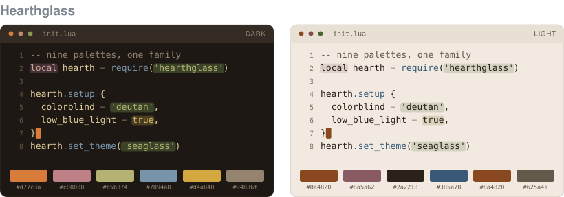
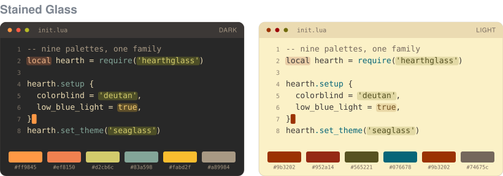
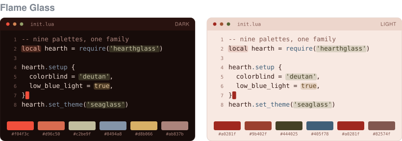
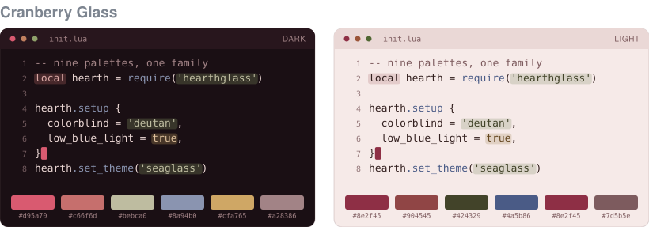
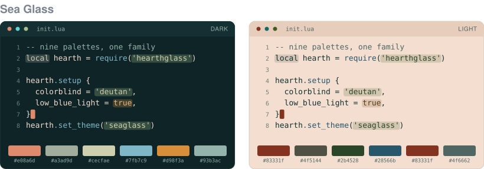
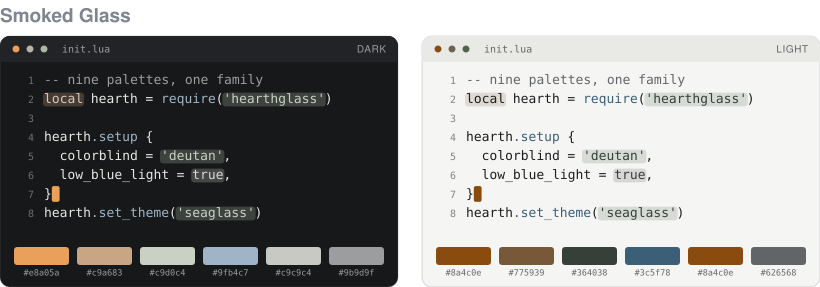
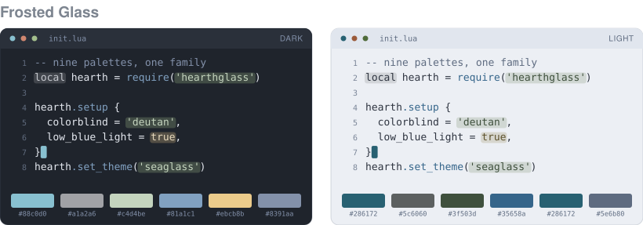
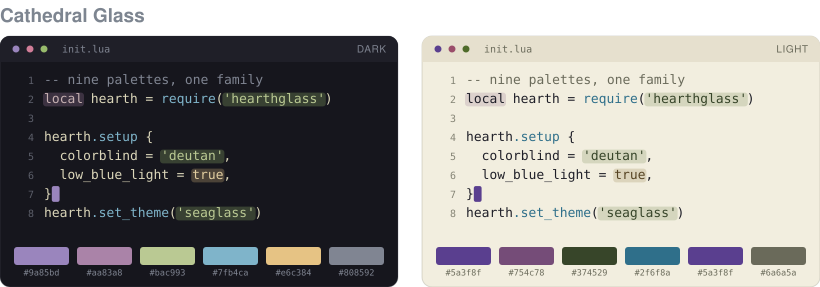
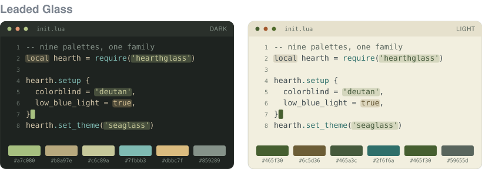

# Hearthglass

<p align="center">
  
</p>

Nine Neovim colorschemes for the glow between dark and light: warm ivory ink
over hearth ash, one hero accent per family, green and red kept for diffs and
diagnostics.



## Themes

Every theme has a dark and a light face. Keys end in `glass`, so
`:colorscheme seaglass` gives you the dark face and `seaglass-light` the light
one.



**Hearthglass** · `hearthglass` — the original: amber hero, ivory ink, hearth
ash.



**Stained Glass** · `stainedglass` — Gruvbox bones, stained-glass fire.



**Flame Glass** · `flameglass` — ruby glass, vermilion fire.



**Cranberry Glass** · `cranberryglass` — cranberry glass over a wine-dark plum.



**Sea Glass** · `seaglass` — sea glass, coral hero, deep teal shadow.



**Smoked Glass** · `smokedglass` — smoked gray surfaces, one warm accent.



**Frosted Glass** · `frostedglass` — polar blue-gray glass, aurora accents.



**Cathedral Glass** · `cathedralglass` — ink black, lilac, peony and carp
yellow.



**Leaded Glass** · `leadedglass` — forest shadow, cream light, autumn orange.

## Install

lazy.nvim:

```lua
{
  'McCune1224/hearthglass.nvim',
  lazy = false,
  priority = 1000,
  config = function()
    vim.cmd.colorscheme 'hearthglass'
  end,
}
```

vim.pack:

```lua
vim.pack.add { 'https://github.com/McCune1224/hearthglass.nvim' }
vim.cmd.colorscheme 'hearthglass'
```

## Usage

```vim
:colorscheme seaglass          " any theme key, dark face
:colorscheme seaglass-light    " its light face
:colorscheme hearthglass-auto  " follow the desktop, fall back to 'background'

:HearthglassTheme leadedglass  " change family, keep the current face
:HearthglassTheme              " list themes, * marks the active one
:HearthglassToggle             " flip dark and light
:HearthglassSync               " re-read the desktop preference
```

The same from Lua:

```lua
local hearthglass = require('hearthglass')
hearthglass.set_theme('cranberryglass')
hearthglass.toggle()
hearthglass.list()
```

`hearthglass-auto` reads `ColorScheme` from `kdeglobals` on KDE and
`org.gnome.desktop.interface color-scheme` through `gsettings` on GNOME.

## Options

```lua
require('hearthglass').setup {
  low_blue_light = true, -- lighter, whiter light face
  colorblind = 'deutan', -- true | 'deutan' | 'protan' | 'tritan'
}
```

`colorblind` retints the one pair the theme uses for meaning — green for
success, red for errors — and the syntax slabs that carry it. It applies to both
faces, survives toggling, and the lualine themes follow it.

## lualine

Every family ships a lualine theme, so the status line can just track the
colorscheme:

```lua
require('lualine').setup {
  options = { theme = vim.g.colors_name },
}
```

## kitty

`kitty/<key>.conf` and `kitty/<key>-light.conf` for every theme, plus a small
CLI that reads `kitty/palettes.json` (exported from the Neovim palettes, so it
honors `colorblind` and `low_blue_light`):

```sh
python3 kitty/hearthglass.py install                 # into `kitten themes`
python3 kitty/hearthglass.py day --theme seaglass    # live switch
python3 kitty/hearthglass.py night --theme seaglass --colorblind deutan
```

`install` gives the picker readable names ("Sea Glass", "Sea Glass Light"). The
live switch needs `allow_remote_control yes` in `kitty.conf`.

## Zed

`zed/<key>.json` carries a dark and a light theme per family:

```sh
nvim --headless -l zed/build.lua --install           # all nine into Zed
nvim --headless -l zed/build.lua --theme seaglass    # or just one
```

Pick "Hearthglass Sea Glass Dark" or "… Light" in the theme picker, or set both
in `settings.json`:

```json
{
  "theme": {
    "mode": "system",
    "light": "Hearthglass Sea Glass Light",
    "dark": "Hearthglass Sea Glass Dark"
  }
}
```

## KDE Plasma

All nine ship as Plasma 6 global themes, light and dark, with the full Clay-style
component set: colors, Plasma style, window decoration, wallpaper, splash, lock
screen, icons, Kate and the Alt+Tab switcher.

```sh
./kde/install.sh
./kde/apply.sh seaglass dark
./kde/verify.sh
```

See [`kde/README.md`](kde/README.md) for the details and the palette mapping.

## Development

The palettes live in `lua/hearthglass/themes.lua` and are expanded by
`colors.lua`. Every integration — and the preview images above — is generated
from those two files:

```sh
nvim --headless -l kitty/export.lua && python3 kitty/hearthglass.py build kitty
nvim --headless -l zed/build.lua
nvim --headless -l kde/export.lua && python3 kde/build.py
nvim --headless -l scripts/build-readme-assets.lua
```

`build-readme-assets.lua --check` fails if the previews above no longer match the
palettes. Three more headless checks cover contrast, drift and loading:

```sh
nvim --headless -l scripts/audit-contrast.lua
nvim --headless -l scripts/check-drift.lua
nvim --headless -l scripts/check-colorschemes.lua
```

## Credits

Structure and palette direction:

- [deepwhite.nvim](https://github.com/Verf/deepwhite.nvim) — highlight-group
  organization and visual structure (MIT)
- [Ember](https://embertheme.com/) and
  [ember-theme/nvim](https://github.com/ember-theme/nvim) — palette direction
  for Hearthglass

Palette ancestors, matched color for color:

- [Gruvbox](https://github.com/morhetz/gruvbox) — Stained Glass
- [Nord](https://www.nordtheme.com/) — Frosted Glass
- [Kanagawa](https://github.com/rebelot/kanagawa.nvim) — Cathedral Glass
- [Everforest](https://github.com/sainnhe/everforest) — Leaded Glass

Sea Glass is anchored to a photographed petal reference instead of an existing
theme: deep teal `#0e2426`, coral petal `#e08a6d`, cyan rim `#5fd6d2`, amber
pollen `#d98f3a`, bone highlight `#f3ded0`.

MIT licensed.
